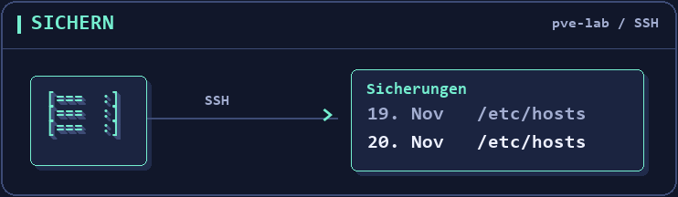
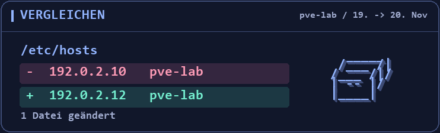
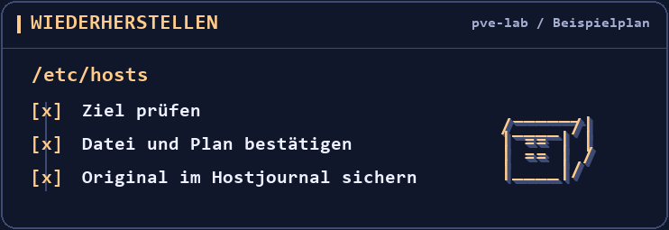
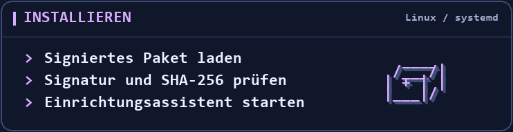

# Anker

**Proxmox-Hostkonfigurationen sichern, vergleichen und gezielt wiederherstellen.**

[`› Fallbeispiel`](#ein-host-zwei-staende) · [`› Installieren`](#installation) · [`› Demo`](#optionale-lokale-demo) · [`› Doku`](docs/README.md)

<picture>
  <source media="(prefers-reduced-motion: no-preference)" srcset="docs/readme/anker.gif">
  
</picture>

Anker ist ein zentraler Dienst für **Proxmox VE** und **Proxmox Backup Server**. Er sammelt Konfigurationen per SSH und speichert sie als lesbare Dateien. Bedienen lässt er sich im Web, im Terminal und per CLI.

<a name="ein-host-zwei-staende"></a>

## Ein Host, zwei Stände

Im Beispiel hat `pve-lab` eine neue Adresse in `/etc/hosts`. Anker hilft, den alten Eintrag zu finden und die passende Fassung für das Ziel auszuwählen.

### Sichern

<picture>
  <source media="(prefers-reduced-motion: no-preference)" srcset="docs/readme/sichern.gif">
  
</picture>

Anker sichert nach Zeitplan oder auf Abruf. Die Stände lassen sich durchsuchen, herunterladen und auf Integrität prüfen.

### Vergleichen

<picture>
  <source media="(prefers-reduced-motion: no-preference)" srcset="docs/readme/vergleichen.gif">
  
</picture>

Im Vergleich steht die alte Adresse neben der neuen. Für die Übernahme wählst du eine Fassung der ganzen Datei. Prüfe deshalb auch die übrigen Zeilen.

### Wiederherstellen

<picture>
  <source media="(prefers-reduced-motion: no-preference)" srcset="docs/readme/wiederherstellen.gif">
  
</picture>

Ziel prüfen, Dateifassung wählen und die Plan-ID bestätigen. `/etc/hosts` ist geschützt und braucht beim Speichern des Plans eine eigene Bestätigung. Vor der Übernahme hält das Hostjournal die ursprüngliche Datei für die Rücksetzung fest. [Ablauf und Grenzen](docs/RECOVERY.md)

> Anker sichert Hostkonfigurationen. VM- und Containerdaten brauchen eigene Gast-Backups. Den Stand der Abnahme für reale Proxmox-Systeme dokumentiert der [Unterstützungsstand](docs/SUPPORT.md).

## Installation



Für den zentralen Dienst einen Linux-Server, eine VM oder einen LXC-Container mit systemd verwenden. Die signierten Pakete unterstützen `amd64` und `arm64`. Für den Installer braucht es Python 3 und OpenSSL 3.

<details>
<summary><strong>Signierten Release installieren</strong></summary>

Aus einem Anker-Checkout starten und den öffentlichen Signierschlüssel vorab unabhängig prüfen.

```sh
sudo python3 scripts/install-release.py --public-key /pfad/zur/geprüften/public.pem
```

Nach der Einrichtung unter **Hosts → Host hinzufügen** den SSH-Fingerprint des ersten Hosts prüfen und **Jetzt sichern** wählen. [Releases](https://github.com/jahartmann/Anker/releases) · [Installationsanleitung](docs/UPDATES.md#erstinstallation-aus-einem-release) · [Installation aus Quellcode](docs/HANDBOOK.md#installation)

</details>

## Optionale lokale Demo

Auf einem Entwicklungsrechner mit Go und `make` im Projektverzeichnis starten.

```sh
make build
./bin/anker --data ./var/demo demo
```

Unter `http://127.0.0.1:8087` mit `demo` und `anker-demo-2026` anmelden. Die Demo verwendet Beispieldaten. [Demo im Handbuch](docs/HANDBOOK.md#optionale-lokale-demo)

## Dokumentation

Die [Dokumentation](docs/README.md) führt von der Erstinstallation bis zum Wiederherstellungstest.

- [`› setup`](docs/HANDBOOK.md) · Anker einrichten und [Hosts anbinden](docs/HANDBOOK.md#proxmox-hosts-anbinden)
- [`› operate`](docs/OPERATIONS.md) · Betrieb, TLS und Speicher
- [`› update`](docs/UPDATES.md) · Signierte Releases und Updates
- [`› restore`](docs/RECOVERY.md) · Zielprüfung, Plan und Rücksetzung
- <a name="pbs-konfiguration-geführt-wiederherstellen"></a>[`› pbs`](docs/HANDBOOK.md#pbs-konfiguration-geführt-wiederherstellen) · PBS-Konfiguration wiederherstellen
- <a name="zeitplan-und-aufträge"></a>[`› jobs`](docs/HANDBOOK.md#zeitplan-und-aufträge) · Sicherungen planen und Fehler verstehen

[Änderungen](CHANGELOG.md) · [Beiträge](CONTRIBUTING.md) · [Sicherheitsmeldungen](SECURITY.md) · [MIT-Lizenz](LICENSE)
